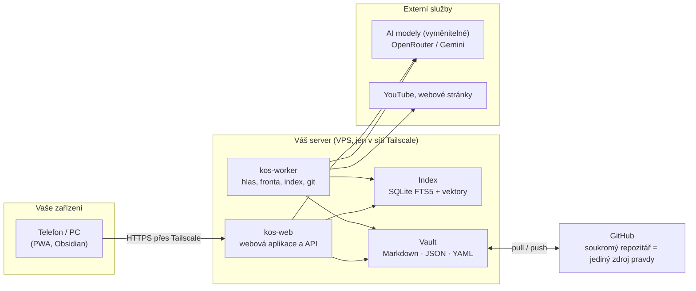

# Knowledge OS

Sdílená znalostní báze s umělou inteligencí pro jednotlivce i malé týmy. Nahrávky přepíše, z jednání připraví
zápis s úkoly, zpracuje dokumenty a na otázky odpovídá **jen z vašich podkladů**, s odkazem na přesné místo ve zdroji.
Data zůstávají u vás v otevřených formátech (Markdown, JSON, YAML, Git), aplikace běží na vlastním malém serveru
v uzavřené síti a AI modely se dají vyměnit v jednom konfiguračním souboru.

> **English summary.** Knowledge OS is a self-hosted, shared knowledge base with AI for individuals and small teams.
> It transcribes voice notes and meetings (with speaker separation), fills in meeting minutes with tasks, ingests
> documents (MD, TXT, DOCX, PDF, web pages) and public YouTube videos, and answers questions **only from your own
> sources**, with every statement linked to the exact place in the transcript or document. Hybrid retrieval
> (full-text with Czech stemming + local semantic embeddings + an entity registry), deterministic citation
> verification, open formats in a Git repository, a PWA for phone and PC, and interchangeable AI models via
> OpenRouter or Google Gemini. Runs on a small VPS behind Tailscale; no public ports. Documentation is in Czech;
> the code and configuration are commented in Czech. MIT licence.

> **Začínáte?** Otevřete [`docs/PRUVODCE.md`](docs/PRUVODCE.md): krok za krokem od nuly k běžící bázi, psáno pro člověka
> bez IT znalostí ve dvojici s AI asistentem (Claude Code apod.). `CLAUDE.md` říká asistentovi, jak průvodce vést.

## Co umí

| Oblast | Funkce |
|---|---|
| **Hlasové poznámky** | Nahrávání v telefonu po 30s kusech (výpadek signálu nevadí), přepis, shrnutí, hlavní body, správné názvy ze slovníku |
| **Schůzky** | Nahrávka → přepis s rozlišením mluvčích → AI vyplní šablonu zápisu (cíl, shrnutí, body, rozhodnutí, úkoly) s odkazy do nahrávky → člověk schválí → karta v Obsidianu a PDF |
| **Dokumenty** | MD, TXT, DOCX, PDF s textem, webové stránky; AI karta (typ, pro koho, platnost, shrnutí); detekce duplicit a nových verzí; týdenní hlídání webových stránek |
| **Videa z YouTube** | Přepis s časy a mluvčími, zarovnání na titulky, kontrola úplnosti, analýza (tvrzení s citacemi, zmínky, kapitoly), karta v Obsidianu |
| **Hledat** | Fulltext tolerantní ke skloňování, filtry (mluvčí, typ zdroje, období), klik skočí na místo ve videu nebo dokumentu |
| **Chat** | Tři úrovně (Light / Standard / Full), odpověď jen z nalezených úryvků, číslované citace barevně podle typu zdroje, chat nad jedním dokumentem, cena každé odpovědi |
| **Entity** | Rejstřík lidí, firem, nástrojů a témat napříč zdroji; postoj (pozitivní/negativní); úklid s AI (sloučit, zamítnout, přetypovat), potvrzuje člověk |
| **Servis** | Úlohy (co běží, co selhalo, opakovat), spotřeba AI v Kč podle účelu a modelu, slovník názvů pro přepis |

## Jak to funguje



Zpracování každého zdroje má šest kroků, každý opakovatelný a se stavem na disku: **přijmout → přepsat → porozumět →
ověřit → uložit → zpřístupnit**. Ověření je deterministické: tvrzení, jehož citace nesedí na přepis, do karty
nejde jako fakt; zmínka entity se zapíše, jen když je název v daném segmentu opravdu přítomný.

Podrobněji: [`docs/INSTALACE.md`](docs/INSTALACE.md) (architektura a instalace), [`docs/UZIVATELSKY_MANUAL.md`](docs/UZIVATELSKY_MANUAL.md)
(práce s aplikací), [`PROJECT_PRINCIPLES.md`](PROJECT_PRINCIPLES.md) (principy návrhu).

## Rychlý start (na PC, bez serveru)

```bash
git clone https://github.com/<váš-účet>/knowledge-os.git
cd knowledge-os
python -m venv .venv && . .venv/bin/activate        # Windows: .venv\Scripts\activate
pip install -r requirements.txt
cp .env.example .env                                 # doplňte OPENROUTER_API_KEY (nebo GEMINI_API_KEY)
python -m pipeline setup                             # průvodce: nástroje, klíč (skrytě), složky, ukázková data
python -m pipeline web                               # http://127.0.0.1:8080
```

Potřebujete Python 3.10+, `ffmpeg` v PATH a klíč k AI modelům. Ukázková data odstraníte příkazem `python demo/remove.py`.
Podrobně, včetně toho, kde klíč a účty získat: `docs/PRUVODCE.md`.
Plnohodnotný provoz (telefon, nahrávání na pozadí, worker, sdílení v týmu) popisuje návod na instalaci na VPS.

## Struktura repozitáře

```
pipeline/            kód aplikace (Python), python -m pipeline <příkaz>
pipeline/web/        webová aplikace (FastAPI + PWA)
tests/               pytest, modely nahrazené napodobeninami (nic nevolá síť)
deploy/              instalace na VPS (systemd, Tailscale), restart, kontrola stavu
docs/                návody
demo/                ukázková data [DEMO] a skripty load.py / remove.py
00_Assets/           originály: přepisy (JSON), dokumenty, audio hlasu a schůzek
01_Zdroje/           karty veřejných zdrojů (videa, veřejné dokumenty) — Markdown pro Obsidian
14_Internal/         soukromé: hlasové poznámky, zápisy ze schůzek, soukromé dokumenty
15–18_Inbox_*/       vstupní složky (soubor sem = do báze)
99_System/           konfigurace (pipeline.yaml, entities.yaml), Slovník.md, šablony zápisů, prompty, stav, index
```

Celý repozitář je zároveň **vault pro Obsidian**: otevřete složku jako vault a čtete karty, přepisy a zápisy
i bez aplikace. Vlastní poznámky pod generovaným blokem karty přežijí přegenerování.

## Modely a náklady

Model je součástka. Který model co dělá, určuje `99_System/config/pipeline.yaml`; výchozí nastavení používá
OpenRouter (přepis Gemini 2.5 Flash-Lite, analýza a chat DeepSeek V4 Flash) s automatickými zálohami. Orientačně:
přepis hodiny nahrávky asi 1 Kč, otázka v chatu haléře, hledání a hledání podle významu zdarma (běží lokálně).
Pro citlivá data lze cestu `private` nasměrovat na jiného poskytovatele nebo vlastní model.

## Bezpečnost

- Aplikace poslouchá jen na `127.0.0.1`; ven ji vystavuje `tailscale serve`, takže je vidět jen ze zařízení ve vaší síti Tailscale.
- Klíče jsou jen v `.env` na serveru (v `.gitignore`); `python -m pipeline doctor` hlídá, že v Gitu nejsou tajemství.
- Všichni v týmu sdílejí vše. Role a oprávnění aplikace nemá; pro více týmů nasaďte více instancí.
- Mazání v aplikaci je vždy na dvě potvrzení; worker nikdy nedělá force push.

## Autor a licence

Ing. Jaroslav Kárník, finanční řízení a AI. Aplikace vznikla metodou vibecodingu (návrh a vývoj s AI asistentem).
Kód je uvolněn pod licencí [MIT](LICENSE): můžete ho používat, upravovat i nasazovat pro sebe nebo pro klienty.
Bez záruky; než ho nasadíte pro citlivá data, projděte si `docs/INSTALACE.md`, část *Bezpečnost*.
